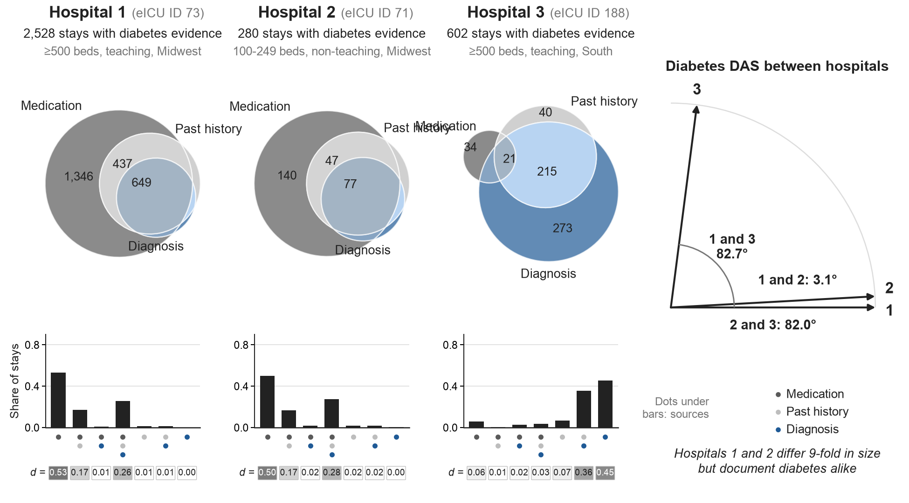

# das-ehr: documentation angular separation

Hospitals record the same condition in different parts of the electronic health record. One hospital documents
diabetes mostly through insulin orders, another through a coded diagnosis, a third through both. **Documentation
angular separation (DAS)** measures that difference between two hospitals as a single angle, from a few aggregate
counts per hospital. No patient-level data leave a site.



*Example: three eICU hospitals. Each stay with evidence of diabetes falls in one of seven lobes, by whether the evidence
is in diagnoses (D), past history (H) or medications (M). Hospitals 1 and 2 spread their evidence almost identically
(DAS 3°). Hospital 3 differs from both (DAS 82°).*

## How DAS is calculated

1. For each hospital and condition, count the stays in each of the seven lobes of the D, H, M Venn diagram:
   D+H+M, D+H, D+M, D only, H+M, H only, M only.
2. Divide by the total to get the hospital's documentation vector $d$.
3. DAS between hospitals $i$ and $j$ for condition $c$ is the angle between their vectors:

$$\mathrm{DAS}_c(i,j) = \arccos\left(\frac{d_{i,c}\cdot d_{j,c}}{\lVert d_{i,c}\rVert\,\lVert d_{j,c}\rVert}\right)$$

DAS runs from 0° (the same spread of evidence) to 90° (no lobe in common).

4. Mean DAS, the main measure in the paper, averages the condition angles over the conditions both hospitals have:

$$\text{mean DAS}(i,j) = \frac{1}{|C_{ij}|}\sum_{c \in C_{ij}} \mathrm{DAS}_c(i,j)$$

where $C_{ij}$ is the set of conditions with a DAS at both hospitals. Mean DAS is not itself an angle between two vectors. It is the average of the condition angles, in degrees, and serves as a summary distance between hospitals.

Because the angle does not depend on scale, a site can share its seven counts per condition instead of shares.

## Install

```bash
pip install git+https://github.com/belouali/das-ehr
```

Requires Python 3.10 or later, numpy and pandas.

## Use

Input: one row per stay, a hospital identifier, and for each condition three true/false columns for evidence in
diagnoses, past history and medications, named `<condition>_D`, `<condition>_H` and `<condition>_M`. How a condition
is identified in each source (codes, terms, drug lists) is up to you.

```python
import das

vectors = das.documentation_vectors(stays, ["diabetes", "hypertension"], min_stays=100)
D = das.mean_das_matrix(vectors)                       # mean DAS between every pair of hospitals

noise = das.split_half_noise(stays, ["diabetes", "hypertension"], vectors)
different = das.beyond_noise(D, noise)                 # pairs that differ beyond within-hospital noise

target = {c: vectors[c].loc["H7"] for c in vectors if "H7" in vectors[c].index}
ranking = das.rank_candidates(target, {c: v.drop(index="H7", errors="ignore") for c, v in vectors.items()})
train_on = das.nearest(ranking, k=10)                  # candidate training hospitals for hospital H7
```

| Function | Returns |
|---|---|
| `lobe_counts(stays, condition)` | hospitals × 7 lobe counts |
| `documentation_vectors(stays, conditions, min_stays)` | documentation vector per hospital, for each condition |
| `das(a, b)` | DAS between two vectors, in degrees |
| `das_matrix(vectors)`, `mean_das_matrix(vectors)` | pairwise DAS for one condition, or mean DAS |
| `split_half_noise(...)`, `beyond_noise(D, noise)` | within-hospital noise floor, and pairs that exceed it |
| `rank_candidates(target, candidates)`, `nearest`, `farthest` | candidate hospitals ordered by DAS to a target |

`examples/quickstart.py` runs the whole sequence on simulated data.

## The paper

`paper/` holds the scripts, configuration and pooled results of the study that introduced DAS, across 152 eICU
hospitals with MIMIC-IV as an external test. `paper/README.md` gives the order of the steps and maps each script to the
paper's tables and figures. The data are available to credentialed users at https://physionet.org and are not in this
repository.

## Citation

Belouali A, Kharrazi H, Sun C-A, Lehmann HP. Site-level EHR documentation variation impacts model inference and
generalizability in multi-center research. Manuscript under review, 2026.

## License

MIT
